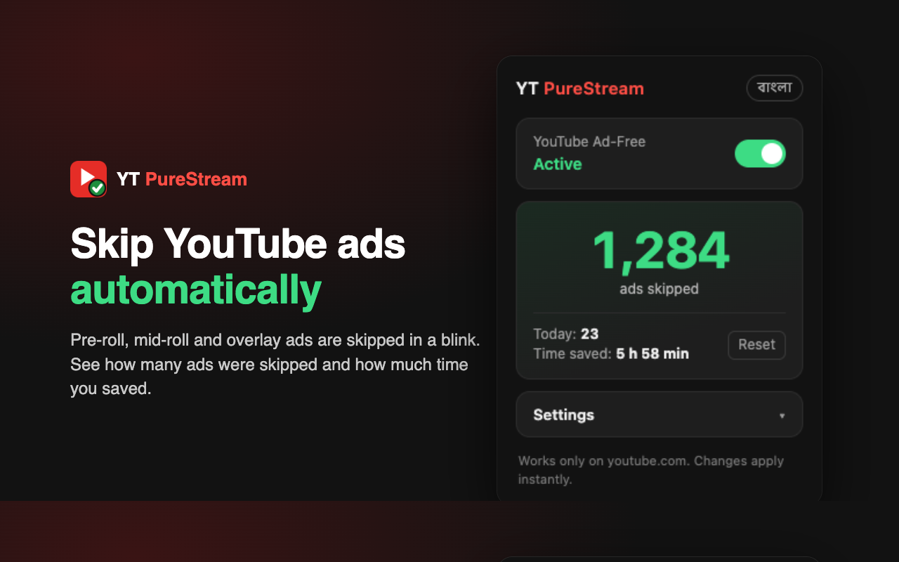
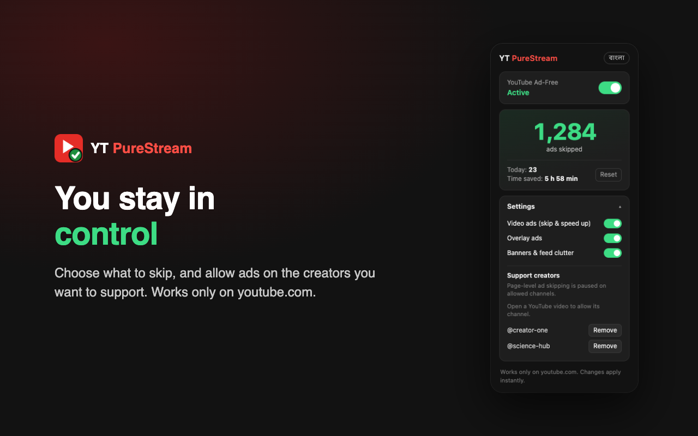

# YT PureStream

[](https://github.com/developermdabdurrahman/yt-purestream/actions/workflows/test.yml)
[](https://github.com/developermdabdurrahman/yt-purestream/releases/latest)
[](LICENSE)

**বাংলা** | [English](#english)



---

# বাংলায় ব্যবহারবিধি

**YT PureStream** একটি হালকা ও ফ্রি ক্রোম এক্সটেনশন। এটা **শুধু youtube.com-এ** ভিডিওর বিজ্ঞাপন (ভিডিওর শুরু, মাঝখান ও ওভারলে বিজ্ঞাপন) নিজে থেকে স্কিপ করে দেয়। অন্য কোনো ওয়েবসাইটে এটা কাজ করে না, আর আপনার কোনো তথ্য সংগ্রহ করে না।

## কী কী সুবিধা পাবেন

- ভিডিওর বিজ্ঞাপন নিজে থেকে স্কিপ হয়: শব্দ বন্ধ হয়, বিজ্ঞাপন দ্রুত শেষ হয়ে যায়, তারপর আপনার আগের ভলিউম ও স্পিড ফিরে আসে।
- ব্যানার ও ফিডের বিজ্ঞাপন লুকিয়ে দেয়। Shorts-এর বিজ্ঞাপনও পাশ কাটায়।
- কতটা বিজ্ঞাপন স্কিপ হলো আর কত সময় বাঁচলো, তা পপআপে ও টুলবার আইকনে দেখায়।
- এক ক্লিকে চালু/বন্ধ করা যায়, পরিবর্তন সঙ্গে সঙ্গে কাজ করে।
- পছন্দের ক্রিয়েটরদের চ্যানেলে বিজ্ঞাপন চলতে দেওয়ার সুবিধা আছে (ক্রিয়েটরদের সাপোর্ট করতে)।
- ইউটিউব অ্যাড ব্লকারের সতর্কবার্তা দেখালে নিজে থেকে "কম্প্যাটিবিলিটি মোড" চালু হয়।
- বাংলা ও ইংরেজি, দুই ভাষাতেই চলে।

## ১. ডাউনলোড করুন

1. [**Releases পেজে যান**](https://github.com/developermdabdurrahman/yt-purestream/releases/latest)।
2. সবচেয়ে নতুন ভার্সনের নিচে **Assets** অংশ থেকে `YT-PureStream-vX.X.X.zip` ফাইলটা ডাউনলোড করুন।
3. ZIP ফাইলটা **আনজিপ (Extract)** করুন। একটা ফোল্ডার তৈরি হবে, যার ভেতরে `manifest.json` ফাইল আছে।

> গুরুত্বপূর্ণ: আনজিপ করা ফোল্ডারটা এমন জায়গায় রাখুন, যেটা পরে মুছে ফেলবেন না (যেমন `Documents`)। ফোল্ডার মুছলে এক্সটেনশনও চলে যাবে।

## ২. ব্রাউজারে ইনস্টল করুন

### Google Chrome
1. অ্যাড্রেস বারে লিখুন `chrome://extensions` এবং Enter চাপুন।
2. উপরে ডান দিকে **Developer mode** (ডেভেলপার মোড) চালু করুন।
3. **Load unpacked** বাটনে ক্লিক করুন।
4. আনজিপ করা ফোল্ডারটা সিলেক্ট করুন (যে ফোল্ডারের ভেতরে `manifest.json` আছে)।
5. তালিকায় **YT PureStream** দেখা গেলে ইনস্টল সফল।
6. টুলবারে পাজল আইকনে ক্লিক করে YT PureStream-এর পাশের **পিন** আইকন চাপুন, তাহলে আইকনটা সবসময় চোখের সামনে থাকবে।

### Brave
- `brave://extensions` খুলে একই ধাপ অনুসরণ করুন।
- মনে রাখবেন, Brave-এর নিজস্ব **Shields**-ও YouTube বিজ্ঞাপন আটকাতে পারে। এক্সটেনশন আলাদাভাবে টেস্ট করতে youtube.com-এ Shields বন্ধ করে দেখুন।

### Microsoft Edge
- `edge://extensions` খুলুন, বাঁ পাশে **Developer mode** চালু করুন, তারপর **Load unpacked** চেপে ফোল্ডারটা সিলেক্ট করুন।

### ৩. YouTube রিলোড করুন
ইনস্টলের আগে যেসব YouTube ট্যাব খোলা ছিল, সেগুলোতে **F5** চেপে রিলোড করুন। রিলোড না করলে ওই ট্যাবে এক্সটেনশন কাজ করবে না।

## ৩. কীভাবে ব্যবহার করবেন

টুলবারের **YT PureStream** আইকনে ক্লিক করলে একটা ছোট প্যানেল খুলবে।

| কী দেখবেন | মানে কী |
|---|---|
| **Active / চালু** (সবুজ সুইচ) | এক্সটেনশন কাজ করছে। সুইচ বন্ধ করলে সব বন্ধ হয়ে যাবে। |
| বড় সবুজ সংখ্যা | এ পর্যন্ত কতটা বিজ্ঞাপন স্কিপ হয়েছে। |
| **Today / আজ** | আজ কতটা স্কিপ হয়েছে। |
| **Time saved / সময় বাঁচানো** | বিজ্ঞাপনের আনুমানিক কত সময় বাঁচলো। |
| **Reset / রিসেট** | কাউন্টার শূন্য করে। ভুলে চাপা ঠেকাতে দুইবার চাপতে হয়। |
| **বাংলা / English** বাটন | ভাষা বদলায়। |
| আইকনের ওপরের সবুজ সংখ্যা | মোট স্কিপ করা বিজ্ঞাপন। বন্ধ থাকলে **OFF** দেখায়। |

### সেটিংস (প্যানেলের নিচে "Settings" / "সেটিংস")
- **ভিডিও বিজ্ঞাপন, ওভারলে বিজ্ঞাপন, ব্যানার ও ফিড:** আলাদা আলাদা করে চালু বা বন্ধ করা যায়।
- **ক্রিয়েটরদের সাপোর্ট করুন:** কোনো চ্যানেলের ভিডিও খোলা অবস্থায় প্যানেল খুলে **বিজ্ঞাপন চলতে দিন (Allow ads)** চাপুন। ওই চ্যানেলে বিজ্ঞাপন আর স্কিপ হবে না। তালিকা থেকে যেকোনো সময় **সরান** দিয়ে ফিরিয়ে নিতে পারবেন।

### হলুদ নোটিস দেখলে
- **"কম্প্যাটিবিলিটি মোড চালু":** YouTube অ্যাড ব্লকার ধরে ফেলেছিল, তাই ভিডিও চালু রাখতে এক্সটেনশন কিছু ব্লক নিজে বন্ধ করেছে। চাইলে "আবার কড়া মোড চালু করুন" চাপতে পারেন।
- **"ইউটিউব সম্ভবত বদলে গেছে":** বিজ্ঞাপন ধরা পড়েছে কিন্তু সামলানো যায়নি। এক্সটেনশনের নতুন ভার্সন আছে কিনা দেখুন।

## ৪. আপডেট করবেন কীভাবে

এই পদ্ধতিতে (স্টোর ছাড়া) আপডেট নিজে থেকে হয় না।
1. [Releases পেজ](https://github.com/developermdabdurrahman/yt-purestream/releases/latest) থেকে নতুন ZIP ডাউনলোড করুন।
2. পুরনো ফোল্ডারের ফাইলগুলো নতুন আনজিপ করা ফাইল দিয়ে বদলে দিন।
3. `chrome://extensions`-এ YT PureStream কার্ডের **Reload (↻)** আইকন চাপুন।
4. YouTube ট্যাবগুলো **F5** দিয়ে রিলোড করুন।

## ৫. সমস্যা হলে

| সমস্যা | সমাধান |
|---|---|
| বিজ্ঞাপন এখনও আসছে | YouTube ট্যাব রিলোড করুন (F5)। পপআপে "Active" আছে কিনা দেখুন। অন্য কোনো অ্যাড ব্লকার চালু থাকলে সেটা বন্ধ করে টেস্ট করুন, কারণ দুটো একসঙ্গে থাকলে ধরা পড়ার সম্ভাবনা বাড়ে। |
| "Ad blockers are not allowed" মেসেজ এসেছে | এক্সটেনশন নিজে থেকে কম্প্যাটিবিলিটি মোড চালু করে পেজ একবার রিলোড করে। তারপরও মেসেজ থাকলে নতুন ভার্সন ডাউনলোড করুন। |
| বন্ধ করার পরেও কাজ করছে মনে হচ্ছে | এক্সটেনশন Reload বা আপডেট করার পর পুরনো খোলা ট্যাব রিলোড করুন। |
| ইনস্টলের সময় Error দেখাচ্ছে | ভুল ফোল্ডার সিলেক্ট করেছেন। যে ফোল্ডারের ভেতরে সরাসরি `manifest.json` আছে সেটা সিলেক্ট করুন (ZIP ফাইল নয়, আনজিপ করা ফোল্ডার)। |
| "Developer mode extensions" নিয়ে সতর্কবার্তা | স্টোর ছাড়া ইনস্টল করা এক্সটেনশনে Chrome এটা দেখায়। এটা স্বাভাবিক। |

কিছু ঠিক না হলে [এখানে একটা Issue খুলুন](https://github.com/developermdabdurrahman/yt-purestream/issues/new) এবং কোন ব্রাউজার ও কী ঘটেছে জানান।

> YouTube প্রায়ই তার প্লেয়ার ও অ্যাড-ব্লকার ধরার পদ্ধতি বদলায়। তাই কোনো এক্সটেনশনই চিরকাল ১০০% কাজ করার নিশ্চয়তা দিতে পারে না। কাজ বন্ধ হলে নতুন ভার্সনের জন্য Releases পেজ দেখুন।

## ৬. গোপনীয়তা

- কোনো ডেটা সংগ্রহ, ট্র্যাকিং বা অ্যানালিটিক্স নেই।
- সেটিংস ও কাউন্টার শুধু আপনার ব্রাউজারেই থাকে, কোথাও পাঠানো হয় না।
- এক্সটেনশন নিজে ইন্টারনেটে কোনো রিকোয়েস্ট করে না এবং শুধু youtube.com-এ চলে।
- বিস্তারিত: [PRIVACY.md](PRIVACY.md)।

## সাপোর্ট ও লাইসেন্স

প্রজেক্টটা ভালো লাগলে GitHub-এ ⭐ **Star** দিন এবং বন্ধুদের সঙ্গে শেয়ার করুন। এটি MIT লাইসেন্সের অধীনে ওপেন সোর্স। YT PureStream একটি স্বাধীন প্রজেক্ট, YouTube বা Google-এর সঙ্গে এর কোনো সম্পর্ক নেই।

---

# English

A tiny, zero-dependency Manifest V3 extension that skips video ads (pre-roll,
mid-roll, overlay) **only on `youtube.com`**. It requests no `<all_urls>`
permission, collects no data and never runs on other sites.



## Features

- Skips video ads: mutes, plays at 16x, jumps to the end, clicks skip/close buttons, then restores your volume and speed.
- Hides banner, feed and sidebar promos (never the player).
- Counter for ads skipped (total / today), estimated **time saved**, and a toolbar badge.
- **Compatibility mode:** if YouTube shows its "Ad blockers are not allowed" dialog, the strict network rules are switched off automatically and the page reloads once.
- Shorts ads are skipped; feed ads are hidden.
- Per-feature switches (video ads, overlay ads, banners/feed) and a **channel allowlist** to support creators.
- Bengali and English interface (switch inside the popup).
- Health notice in the popup if YouTube changes and ads can no longer be handled.

## How it works

| Layer | File | What it does |
|-------|------|--------------|
| Network | `rules_core.json` | Blocks `youtube.com/pagead/*` and `doubleclick.net`, only when the request comes from youtube.com. |
| Network | `rules_strict.json` | Blocks `youtube.com/ptracking*` and `/api/stats/ads*`. Turned off by compatibility mode. |
| Behaviour | `content.js` | Watches `#movie_player`, skips ads, handles Shorts, SPA navigation, allowlist, anti-adblock detection and health reports. Stops itself if the extension is reloaded or removed. |
| Cosmetic | `styles.css` | Hides promo clutter, gated by attributes set from the popup switches. Never hides `#movie_player`. |
| UI | `popup.html`, `popup.js`, `_locales/` | Switch, counters, settings, notices, language. |
| Service worker | `background.js`, `common.js` | Keeps rulesets in sync, owns the counters, compatibility mode, toolbar badge. |

Core player scripts (`base.js`), thumbnails, comments and `videoplayback`
requests are never blocked (verified by the automated tests).

## Install (unpacked)

1. Download `YT-PureStream-vX.X.X.zip` from the [latest release](https://github.com/developermdabdurrahman/yt-purestream/releases/latest) and unzip it (or clone this repo).
2. Open `chrome://extensions` (Brave: `brave://extensions`, Edge: `edge://extensions`).
3. Enable **Developer mode**.
4. Click **Load unpacked** and select the folder that contains `manifest.json`.
5. Pin the extension and reload any open YouTube tabs.

## Usage

- Click the toolbar icon and flip the main switch. "Active" = ad skipping, network rules and cosmetic hiding are on; "Paused" = everything is off. Changes apply immediately, no reload needed (tabs that were open before an extension reload need one page refresh).
- **Settings** (in the popup): choose which kinds of ads to handle, and allow ads on specific channels. To allow a channel, open one of its videos, open the popup and press **Allow ads**. Note: the allowlist pauses *page-level* skipping; the network rules still apply.
- **Language:** the button at the top right switches between English and Bengali.
- **Reset** clears the counters (press twice to confirm).

## Sharing

| Method | Best for | Notes |
|--------|----------|-------|
| **GitHub Releases** | Friends, quick sharing | Push a version tag; the ZIP is built and attached automatically (see below). Friends unzip and "Load unpacked". No automatic updates. |
| **Chrome Web Store** | Non-technical users | One-click install and automatic updates. One-time $5 developer fee; review takes a few days. Listing text and images: [STORE_LISTING.md](STORE_LISTING.md), `store/`. |
| **Microsoft Edge Add-ons** | Edge users | Free to publish; same ZIP works. |

### Make a release (GitHub)
1. Bump `version` in **both** `manifest.json` and `package.json`, and add notes to `CHANGELOG.md`.
2. Commit, then tag and push:
   ```
   git tag v1.2.1
   git push origin main --tags
   ```
3. The **Release** workflow runs the tests, builds `YT-PureStream-v1.2.1.zip` and attaches it to a new GitHub Release. Share the Release page link.

You can also build the ZIP locally: `npm run build` creates `dist/YT-PureStream-v<version>.zip` with runtime files only.

### Publish the privacy policy
The Web Store needs a privacy policy URL. In the GitHub repo open **Settings → Pages**, choose **Deploy from a branch** → `main` / `(root)`. After a minute `PRIVACY.md` is available at `https://developermdabdurrahman.github.io/yt-purestream/PRIVACY`.

### Optional "Support this project" link
Set `SUPPORT_URL` at the top of `common.js` (for example a GitHub Sponsors, Ko-fi or Buy Me a Coffee page). When it is empty the link is hidden. No payment code is included in the extension.

## Development

```
npm install                 # installs playwright-core (dev only)
npm run install:browser     # downloads Chromium for the tests
npm test                    # end-to-end tests against a mock YouTube page
npm run build               # dist/YT-PureStream-v<version>.zip
npm run store-assets        # regenerates the images in store/
```

The tests load the real extension into Chromium and serve a mock `youtube.com`
page, so they check ad skipping, restore of volume/speed, rules, counters,
compatibility mode, the popup, languages, the allowlist and what happens when
the extension is reloaded, without real ads. GitHub Actions (`.github/workflows/`)
runs them on every push and before each release.

## Notes & troubleshooting

- **Ads still appear / "Ad blockers are not allowed" popup?** YouTube changes its player and anti-adblock logic often, and no extension can guarantee permanent results. Compatibility mode handles the warning automatically (a yellow notice appears in the popup). If the warning remains or the popup says "YouTube may have changed", update the extension.
- Don't run another ad blocker alongside this one on YouTube; stacked blockers are more detectable.
- The jump-to-end is skipped for streams longer than 180 s (`MAX_SEEKABLE_AD_SECONDS` in `content.js`) so real content is never skipped if an ad is stitched into the stream.
- Shorts and feed-ad detection is best effort: YouTube renames these elements often.
- The extension makes no network requests of its own. See [PRIVACY.md](PRIVACY.md).

## License

[MIT](LICENSE). Not affiliated with, endorsed by, or sponsored by YouTube or Google.
